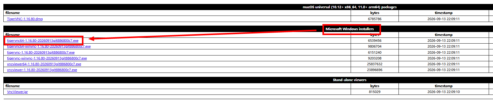
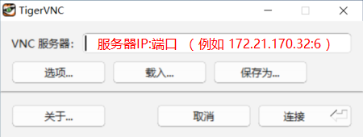
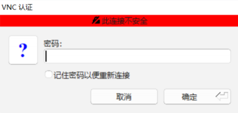
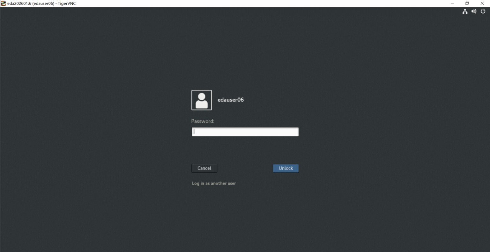

# PyAether 系统学习教程（详细版）

## —— 从"这到底是什么"到"每一步怎么做"

> **面向对象**：零基础、要参加"中国电子杯"模拟电路 AI 智能化设计赛题的同学。
> **编写目标**：① 从根上理解 EDA、模拟电路、PyAether 各是什么；② 每个环节都给出可照着做的操作步骤；
> ③ 学完能独立走通"自然语言 → Spec → 拓扑识别 → 尺寸优化 → 反标 → 提交"全链路。
> **使用方式**：不要跳读第一、二部分。**原理没懂就直接抄操作，遇到报错会完全无法自救。**

---

### 阅读约定

| 标记 | 含义 |
|---|---|
| 【官】 | 官方来源：竞赛问卷原题 / 赛题 PDF 原文 / 赛题提供的真实网表与文件 |
| 【通】 | 通识知识说明，帮助你理解原理，不是官方原文 |
| 【操作】 | 可以照着敲、照着点的步骤 |
| 【验收】 | 怎么判断这一步真的做成了 |
| 【坑】 | 新手最容易踩的错 |

**关于命令签名**：本教程中的命令名、工具名、参数名均来自官方来源；但**完整参数签名（顺序、可选值、返回值）请以华大九天官方文档为准**。本教程不编造未经核实的签名。

---

# 目录

- **第一部分 从根上理解：这到底是什么**
  - 1. 芯片为什么要"设计"
  - 2. 模拟设计为什么难 —— 赛题的由来
  - 3. 这个赛题到底要你做什么
- **第二部分 概念地基**
  - 4. 电路是怎么被"描述"的
  - 5. 运放与六大指标
  - 6. 华大九天工具生态
- **第三部分 PyAether 是什么**
  - 7. PyAether 的定位
  - 8. 数据模型 `emy*`
  - 9. `ae` / `db` / `cdf` 命令详解
- **第四部分 环境搭建（带截图操作）**
  - 10. 环节 A：登录服务器
  - 11. 环节 B：准备工程、跑通官方样例
  - 12. 环节 C：认识你的电路
- **第五部分 赛题全链路（十环节，每个都带操作）**
  - 13~22. 环节 1 ~ 环节 10
- **第六部分 交付、排错与自测**
  - 23~27

---

# 第一部分 · 从根上理解：这到底是什么

## 1. 芯片为什么要"设计"

### 1.1 一个必须先建立的认知：芯片不能"试出来"

【通】假设你要做一块指甲盖大小的芯片。它内部有几十亿个晶体管，是**用光刻机一层一层"印"出来的**——这就是"流片"。

一次流片的成本：

| 工艺节点 | 一次流片（Mask + 试产）大致花费 |
|---|---|
| 180nm | 几十万人民币 |
| 65nm | 几百万 |
| 7nm | 上亿 |

更致命的是**时间**：一次流片从提交到拿到样片要几个月。如果错了，几个月和几百万一起烧掉。

> **结论**：芯片必须在**送去制造之前**，在电脑里被完整验证到"有把握"。这套"在电脑里设计和验证芯片"的软件工具，就叫 **EDA（Electronic Design Automation，电子设计自动化）**。

**所以 EDA 的本质**：用软件模拟物理世界，把"试错成本"从几百万降到几乎为零。

### 1.2 芯片设计的大致分工

【通】一颗芯片的设计，粗略分成两条路：

| | 数字电路 | 模拟电路 |
|---|---|---|
| 例子 | CPU、内存控制器 | 运放、电源管理、ADC 里的模拟部分 |
| 特点 | 逻辑规整，可高度自动化 | 连续信号，**极其依赖工程师经验** |
| 自动化程度 | 高（综合、布局布线全自动） | **低**（大量手工调整） |

本赛题属于**模拟电路**这一侧——也正是自动化最难、最需要突破的地方。

---

## 2. 模拟设计为什么难 —— 赛题的由来

### 2.1 人工设计一个运放，工程师在做什么

【通】假设要设计一个运放，指标是"增益 ≥ 90dB、带宽 ≥ 60MHz、电流 ≤ 3mA"。工程师的一天是这样的：

1. **读 Spec**：把客户的自然语言要求，翻译成一组数值指标和优先级。
2. **选拓扑**：决定用几级放大、用不用 cascode（共源共栅）、要不要共模反馈。这一步靠经验。
3. **分配指标**：增益 90dB 怎么分摊到每一级？带宽怎么分？靠经验。
4. **定尺寸**：每个晶体管多宽（W）、多长（L）、并联几个（m）。**这是最耗时的部分。**
5. **仿真**：跑一次，看结果。
6. **调**：不达标就改几个尺寸，再跑。**重复几十到几百次。**
7. **验证**：所有 PVT corner 都跑一遍，确认没有死角。

### 2.2 痛在哪里

| 环节 | 痛点 |
|---|---|
| Spec 解析 | 人手翻译，容易漏、容易理解偏差 |
| 拓扑选择 | 完全依赖经验，无法复用 |
| **尺寸调整** | **几百次仿真，每次几分钟到几小时，全靠人盯** |
| PVT 验证 | 组合爆炸，工作量大 |

第 3 行就是本赛题要解决的核心：**用一个"智能体"自动完成 Spec 解析、拓扑识别、尺寸优化。**

### 2.3 赛题的官方表述

【官】赛题原文：

> 本赛题构建模拟电路智能设计体，实现三大核心能力：**自然语言 Spec 解析、拓扑模块识别与参数约减、多目标尺寸优化**，在给定 PyAether 自动化流程与 PDK 约束下，输出满足 Spec 的最优拓扑与尺寸方案。

**翻译成人话**：

```
① 听懂人话   →  ② 看懂电路图，找出哪些参数可以调  →  ③ 自动反复试，找到最好的一组尺寸
```

---

## 3. 这个赛题到底要你做什么

### 3.1 一句话版本

**写一个 Python 程序，让电脑自动调电路里晶体管的尺寸，直到电路性能达标并且尽可能好。**

### 3.2 全景图

```
┌──────────────────────────────────────────────────────────────┐
│  你在本地电脑（Python + 大模型 API）                          │
│                                                              │
│   [环节1] 自然语言 Spec → JSON                                │
│   [环节2] 电路网表 → 拓扑识别 → 参数约减                       │
│   [环节5] 优化算法：不断生成新的"尺寸文件" ◄──┐                │
│                                              │                │
└──────────────────────────────────────────────┼────────────────┘
                                               │ 尺寸文件
                                               ▼
┌──────────────────────────────────────────────────────────────┐
│  华大九天服务器（VNC 登录，Linux）                             │
│                                                              │
│   [环节3] 参数化电路图（尺寸变成变量）                          │
│   [环节4] 仿真引擎：改尺寸 → 调 MDE 跑 PVT → 提取性能 ────────┘ │
│   [环节7] 反标：把最优尺寸写回电路图                            │
│   [环节8] 提交 tar.gz 压缩包                                   │
└──────────────────────────────────────────────────────────────┘
```

### 3.3 你最终要交的东西

【官】提交物清单：

| 类别 | 具体内容 | 硬性格式 |
|---|---|---|
| **代码** | `eda_2026_case_1.tar.gz`，内含 `eda_2026_case_1/optimization.py` | **名称与结构必须完全一致** |
| **技术报告** | Doc + PDF 各一份 | ≤ 80 页 |
| **汇报 PPT** | 项目背景、方案、工作、结果 | ≤ 20 页 |
| **演示视频** | MP4 | ≤ 5 分钟 |
| **问卷** | PyAether 基础知识问卷 | 三人全做，取最高分 |

### 3.4 分数怎么算（**决定你的策略**）

【官】初赛总分 100：

| 大项 | 分值 | 说明 |
|---|---|---|
| 通用提交报告 | 20 | 技术报告 + 源码 + PPT + 视频，考察**完整性** |
| 客观性能 | 70 | 见下表 |
| PyAether 问卷 | 10 | 最高分 ÷ 100 × 10 |

客观性能 70 分的细分，**注意三种截然不同的性质**：

| 项目 | 分值 | 性质 | 你必须 |
|---|---|---|---|
| PM ≥ 50°、GM ≤ -10dB、I_OPA ≤ 3mA（**所有 PVT**） | 30 | **二值**：任一不满足，该项直接 0 分 | **死保** |
| DC Gain ≥ 40dB | 10 | **排名分**：`Gain₁/Gain₀×10`，< 40dB 记 0 | 冲 |
| UGB | 15 | **排名分**：`UGB₁/UGB₀×15` | 冲 |
| 面积 | 15 | **排名分**：`A₀/A₁×15` | 冲 |
| 运行时间 | 10 | `T₀/T₁×10`，**每违反一条约束再扣 5 分** | 控时 |

**读出来的三个结论**：

1. 约束不满足会被**双重惩罚**（该项 0 分 + 时间项扣 5 分）→ 约束必须优先锁死。
2. 目标分是**相对排名**，比对手好一点就多拿分 → 要持续优化，不能"达标就停"。
3. **运行时间本身是分** → 仿真次数是稀缺资源，必须精打细算。

### 3.5 时间限制

【官】单个运放电路总体代码运行时间上限 **3 小时**。公开的 Public 电路不参与评分，隐藏的 Hidden 电路参与评分——**所以算法必须通用，不能只针对公开电路调参**。

---

# 第二部分 · 概念地基

## 4. 电路是怎么被"描述"的

### 4.1 器件：晶体管有哪几个数字可调

【通】一个 MOS 晶体管，几何上有三个关键参数：

| 参数 | 符号 | 含义 | 影响 |
|---|---|---|---|
| 宽度 | W（网表里常写作 `fw`） | 沟道宽度 | 越宽，驱动能力越强，电流越大，面积越大 |
| 长度 | L | 沟道长度 | 越长，增益越高（输出阻抗大），但速度越慢 |
| 并联数 | m（multiplier） | 相当于并排 m 个相同管子 | 等效 W 放大 m 倍，面积也放大 m 倍 |

**电阻**用 `seg`（segment，段数）描述，**电容**用 `W`、`L` 描述。

> 记住这张表，你就理解了"尺寸优化"到底在优化什么——**就是给这些数字找一组好值。**

### 4.2 连接关系：net / inst / term

【通】

| 概念 | 中文 | 例子 |
|---|---|---|
| **inst**（instance） | 实例 | `NM15` 这个晶体管 |
| **net** | 网络 / 连线 | `VOUTN`、`net52` |
| **term**（terminal） | 端子 / 引脚 | 某个器件的 G、D、S、B |

**电路 = 一堆器件（inst）+ 它们之间怎么连（net）。** 这就是全部。

### 4.3 库 / 单元 / 视图

【官+通】Aether 用三层结构管理设计：

| 概念 | 英文 | 类比 | 例子 |
|---|---|---|---|
| 库 | lib | 一本书 | `2026_EDA_case1` |
| 单元 | cell | 书里的一章 | `OPA` |
| 视图 | view | 同一章的多种版本 | `schematic` |

**三者组合唯一确定一份设计**：`2026_EDA_case1 / OPA / schematic`。

**三种视图的区别（高频考点）**：

| 视图 | 内容 | 用途 |
|---|---|---|
| `schematic` | 器件 + 连线，描述电学连接 | **仿真用这个** |
| `symbol` | 一个带引脚的方块 | 被上层调用时显示 |
| `layout` | 真实几何图形 | 制造与物理验证 |

### 4.4 网表：电路的文字版

【官】网表（netlist）是把电路写成文本。赛题给的 `OPA_loopgain.netlist` 开头：

```spectre
subckt OPA (IREF GNDA SUB VCM VDDA VINN VINP VOUTN VOUTP)
NM15 (VOUTN IREF VOUTN SUB) n_mos_a l=NM15_l w=NM15_fw multi=1 m=NM15_m
NM14 (VOUTP IREF VOUTP SUB) n_mos_a l=NM14_l w=NM14_fw multi=1 m=NM14_m
```

**逐段读法**：

| 位置 | 含义 | 本例 |
|---|---|---|
| `subckt OPA (...)` | 定义子电路 `OPA`，括号内是**对外端口** | `VINN VINP VOUTN VOUTP` 等 |
| `NM15` | 实例名 | NM = NMOS，编号 15 |
| `(VOUTN IREF VOUTN SUB)` | 四个节点，顺序是 **D G S B** | 漏、栅、源、衬底 |
| `n_mos_a` | 器件模型名（来自 PDK） | 0.13µm 工艺 NMOS |
| `l=NM15_l w=NM15_fw` | **尺寸参数，已经是变量** | 要优化的对象 |
| `m=NM15_m` | 并联个数 | 整数 1~20 |

**关键发现**：赛题网表里的尺寸**已经被参数化**了（`NM15_l`、`NM15_fw`、`NM15_m` 这种"实例名_参数名"写法）。这正是 PyAether 参数化脚本的产物。

【官】赛题 PDF 明确说明变量命名规则：**instance 名 + `_cdf` 参数**，例如 `NM1_m`。

---

## 5. 运放与六大指标

### 5.1 运放是什么

【通】运放（运算放大器）是模拟电路里最基础的"放大单元"：把两个输入端的**微小电压差**，放大成很大的输出。

"运算"这个词是历史遗留——早期用它搭模拟计算机做加减乘除。今天它主要用来做**放大、缓冲、反馈控制**。

### 5.2 差分、全差分与共模反馈

【通】

- **单端**：一个输入，一个输出（对地）。
- **差分**：两个输入，处理的是 **V+ − V−** 的差。
- **全差分**：两个输入 + **两个输出**（`VOUTP` / `VOUTN`），输出也是差分的。

全差分的好处：抗干扰强、动态范围大。**代价**：输出的"共模电平"（两路输出的平均值）会乱飘，必须额外加一个电路把它稳在设定值上——这就是**共模反馈（CMFB）**。

**在网表里怎么认出 CMFB** ——【官】节点名直接暴露了它：

```
outaverage   ← 把 VOUTP 和 VOUTN 取平均
vcmfb        ← 共模反馈控制信号
VCM          ← 目标共模电平（输入）
```

### 5.3 六大指标逐个讲透

#### ① 开环直流增益 DC Gain

| 问题 | 回答 |
|---|---|
| 是什么 | 频率趋近 0 时的放大倍数，单位 dB。60dB ≈ 1000 倍 |
| 为什么重要 | 增益越高，闭环精度越高，是做 ADC、基准源的前提 |
| 赛题要求 | **≥ 40dB（低于 40dB 该项直接记 0 分）**，且越大越好 |
| 怎么提高 | 增大 L、用 cascode 结构、增加增益级数 |
| 代价 | 带宽下降、面积增大 |

#### ② 单位增益带宽 UGB

| 问题 | 回答 |
|---|---|
| 是什么 | 开环增益降到 1（0dB）时的频率，代表"能处理多快" |
| 赛题要求 | **越大越好**（15 分排名分） |
| 怎么提高 | 增大偏置电流、减小 L、增大 W/L |
| 代价 | 功耗增大，且**与增益方向相反** |

#### ③ 相位裕度 PM

| 问题 | 回答 |
|---|---|
| 是什么 | 环路增益降到 1 时，相位离 -180° 还差多少度 |
| 为什么重要 | 这是**稳定性**指标。不够就会振荡，电路直接不能用 |
| 赛题要求 | **PM ≥ 50°，所有 PVT 都要满足**（10 分） |
| 怎么调 | 主要靠**补偿电容**（网表里的 `C0`~`C5`、`C11`）。电容大 → PM 好 |
| 代价 | 带宽下降、面积增大 |

#### ④ 增益裕度 GM

| 问题 | 回答 |
|---|---|
| 是什么 | 相位到 -180° 时，增益距 1 还差多少（dB） |
| 赛题要求 | **GM ≤ -10dB，所有 PVT**（10 分） |
| 直观理解 | 负得越多越安全 |

> ※ **一句记忆**：PM 是"离振荡还有多少度"，GM 是"离振荡还有多少倍衰减"。

#### ⑤ 工作电流 I_OPA

| 问题 | 回答 |
|---|---|
| 是什么 | 电路总消耗电流，乘电压就是功耗 |
| 赛题要求 | **≤ 3mA，所有 PVT**（10 分） |
| 怎么调 | 偏置电流 `I_BIAS`（`.scs` 里是 10µA）与各支路电流镜比例 |
| 代价 | 降电流 = 降带宽、降增益 |

#### ⑥ 面积 Area

【官】官方给的面积公式：

| 器件 | 面积公式 |
|---|---|
| 晶体管 | `fw × L × m × 1.5` |
| 电容 | `W × L × 1` |
| 电阻 | `W × L × 2` |

**系数记牢：MOS 1.5、电容 1、电阻 2。别忘了乘 `m`。**

### 5.4 为什么这些指标互相打架

【通】这是理解"为什么要多目标优化"的关键：

| 你想做的事 | 副作用 |
|---|---|
| 增大 L 提高增益 | 带宽下降 |
| 增大电流提高带宽 | 功耗超标 |
| 增大补偿电容改善 PM | 带宽下降、面积增大 |
| 增大 W 提高驱动能力 | 面积增大、寄生电容增大 |

**没有任何一个调节是"只有好处"的。** 所以不可能靠"照着规则调"解决，只能用**多目标优化算法**在互相矛盾的目标间找平衡点。

### 5.5 PVT：为什么所有角都要过

【通】PVT = **P**rocess（工艺）+ **V**oltage（电压）+ **T**emperature（温度）。

芯片制造有偏差、供电会波动、温度会变化。同一个设计在不同条件下表现完全不同。必须在最坏的情况下也满足指标。

【官】赛题要求的覆盖范围：

| 维度 | 取值 |
|---|---|
| 工艺 | TT（典型）/ FF（快）/ SS（慢） |
| 温度 | 125℃ / -40℃（以及常温 27℃） |
| 电压 | 标称 ±10% |

**评分关键**：所有性能指标取**所有 PVT 下最坏的那个值**。所以优化时只看典型（TYP）会踩坑。

---

## 6. 华大九天工具生态

### 6.1 全景分类

```
┌──────────── 设计与仿真 ────────────┐
│ Aether（画图）  MDE（管仿真）        │
│ ALPS / ALPS CS（跑仿真）            │
│ ArtemisFPD（显示面板专用）          │
└────────────────────────────────────┘
┌──────────── 数据与模型 ────────────┐
│ ADA（寄生参数）  Liberal 家族（K库）  │
└────────────────────────────────────┘
┌────────── 版图 · 验证 · 制造 ───────┐
│ Vision（良率）  Argus（物理验证）    │
│ Storm（先进封装） Polas（功率电路）   │
└────────────────────────────────────┘
┌──────────── 自动化与扩展 ───────────┐
│ PyAether（Python 接口）              │
│ AetherWings（版图辅助工具集）        │
└────────────────────────────────────┘
```

### 6.2 仿真类

| 工具 | 定位 | 必背关键词 |
|---|---|---|
| **ALPS** | 大规模高精度电路仿真器 | 大规模、**Snapshot**（快照：快速保存/恢复仿真状态，提升大规模仿真效率） |
| **ALPS CS** | 数模混合仿真 | **数模域同步协同 + 并行计算** |
| **ArtemisFPD** | 平板显示（FPD）仿真 | **显控一体**、**Noise 噪声/信号干扰分析** |

> 【通】Snapshot 为什么重要：跑一次长瞬态仿真可能几小时，Snapshot 让你"存档"，下次从中断处继续，不用重跑。

### 6.3 寄生参数与 K 库

【通】先理解 **K 库**：K 库（特征化库）描述器件和单元在不同条件（电压、温度、负载）下的行为，供上层工具快速查表。K 库的准确度和生成速度，直接决定整条流程的效率。

| 工具 | 定位 | 必背关键词 |
|---|---|---|
| **ADA** | **版图寄生参数**分析工具 | 新一代寄生参数分析 |
| **Liberal** | 全栈式 **K 库**解决方案 | 主要赋能**模拟 IC 设计** |
| **Liberal GT** | K 库**优化**工具 | 全球首发、**10X 提速**、GPU 加速 |
| **Liberal Mem** | 存储器特征化 | 效率提升 **100X** |
| **Liberal IP** | 混合信号 IP 设计 | **LVF 精准 K 库** |

> ⚠️ **易混**：Liberal **Mem** 是 **100X**（存储器），Liberal **GT** 是 **10X**（GPU 加速）。问卷最爱考这两个数字。

### 6.4 版图 · 验证 · 制造

| 工具 | 定位 | 必背关键词 |
|---|---|---|
| **Vision / Vision CA** | 版图处理与良率提升 | **Care Area 精准提取**、晶圆制造良率 |
| **Argus** | **物理验证** | 覆盖广：**大规模数字 SoC、泛模拟、3D IC/Chiplet、射频版图** |
| **Storm** | **先进封装**设计平台 | 全球首发、**Chiplet 布线效率提升 1–2 倍**、支持 3D |
| **Polas** | **功率（电源）电路**设计 | 与功率电路强相关 |

【通】**DRC / LVS 是什么**：

- **DRC**（Design Rule Check）：检查图形是否符合工艺规则（最小线宽、最小间距…）。
- **LVS**（Layout Versus Schematic）：检查版图和电路图的连接关系是否一致。

### 6.5 平台类

| 组件 | 作用 |
|---|---|
| **Aether** | 全定制（模拟）设计平台：画 schematic / symbol / layout 的主战场 |
| **MDE** | 仿真管理环境：配置 corner、一键跑仿真、汇总结果 |
| **AetherWings** | 版图辅助工具集 |
| **PyAether** | 把上面这些操作变成 **Python 命令** |

---

# 第三部分 · PyAether 是什么

## 7. PyAether 的定位

### 7.1 先澄清：它**不是**什么

【通】网上很多关于 PyAether 的文章是 AI 生成的，会写 `from pyaether import Cell` 这种**并不存在**的 API。请记住：

- 它**不是**一个通用的 Python 库（不像 numpy 那样 `pip install` 就能随便用）。
- 它**必须运行在 Aether 环境里**（在服务器上、有 license、有工程上下文）。
- 它**不能脱离 Aether 单独使用**。

### 7.2 它**是**什么

**PyAether = 把 Aether 平台的鼠标操作，变成 Python 代码。**

一句话对照：

| 你在 Aether 界面做的事 | PyAether 里的写法 |
|---|---|
| 点菜单新建库 | 调用建库命令 |
| 拖一个器件进来 | 调用建实例命令 |
| 双击器件改 W/L | 调用 CDF 设参命令 |
| 点"运行仿真" | 调用 MDE 接口 |

**为什么这件事重要**：一旦操作变成代码，就可以**循环、批量、接入优化算法**——这正是本赛题的基础。

### 7.3 命令命名体系（**全篇最重要的表**）

【官】

| 前缀 | 中文 | 管什么 | 例子 |
|---|---|---|---|
| `ae…` | Ae Commands | Aether 交互对象：画图形、开菜单、改属性 | `aeCreateRect`、`aeMoveObj` |
| `db…` | 数据库/版图命令 | 底层数据：库、单元、视图、版图图形 | `dbCrtVia`、`dbOpenCV` |
| `cdf…` | CDF 命令 | 器件参数表 | `cdfGetCDF` |
| `emy…` | Python 数据模型类 | 把库/网表/图形包装成对象 | `emyDesign`、`emyNet` |
| `dm…` | 数据管理类 | 文档、文件、单元对象 | `dmCellObj` |

> **口诀：ae 画图、db 建库、cdf 调参、emy 建模、dm 管文件。**
>
> 看到不认识的命令，**先看前缀猜分类**——这一个技巧能排除一半错误选项。

---

## 8. 数据模型 `emy*` 类

【官】PyAether 把 Aether 数据库里的东西包装成 Python 对象。

| 类 | 代表什么 | 关键属性 / 方法 |
|---|---|---|
| `emyDatabase` | 数据库总入口 | 打开库、遍历设计 |
| `emyDesign` | 一个设计 | `name`、`cells`、`layers`、`views` |
| `emyNet` | 网络（连线） | 基类 |
| `emyScalarNet` / `emyBusNet` / `emyBundleNet` | 标量网络 / 总线 / 捆绑线 | `emyNet` 的子类 |
| `emyInst` | 实例（一个器件） | 取参数、取端口 |
| `emyTerm` | 端子（引脚） | 所属网络 |
| `emyFig` | 图形基类 | — |
| `emyRoute` | 走线 | **继承自 `emyFig`** |
| `emyBox` | 矩形区域 | `isInverted()` 判断坐标是否倒序 |
| `emyBoundary` / `emyAreaBoundary` / `emyClusterBoundary` / `emyPRBoundary` | 各类边界 | 区域、簇、物理边界 |
| `emyAttrDisplay` | 属性显示器 | 创建时 `object` 可为 `emyNet` / `emyInst` / `emyTerm`（**以上都是**） |
| `emyAntennaModel` / `emyAntennaData` / `emyAntennaRatioValue` | 天线效应 | — |
| `emyAntennaData` 的方法 | 取各类天线面积数组 | `diff`、`gate`、`maxCAR`、`partialMetal` |

**数据管理类**：

| 类 | 作用 |
|---|---|
| `dmCellObj.getCell()` | 取单元信息：`name`、`type`、`readPath`、`writePath` |
| `dmCellFileObj` | 文件对象：文件类型、所属单元、所属库、读写路径 |

**扩展模块**：提供 **Query、GOA** 等拓展功能的模块叫 **Extension**。

---

## 9. `ae` / `db` / `cdf` 命令详解

### 9.1 库 / 单元 / 视图

| 命令 | 作用 |
|---|---|
| `aeNewLib` / `aeDelLib` / `aeCopyLib` | 新建 / 删除 / 复制**库** |
| `aeNewCell` / `aeDelCell` | 新建 / 删除**单元** |
| `aeScheViewToView` | **视图互转**（schematic ↔ symbol） |
| `aeDesignIsLayout` / `aeDesignIsSchematic` / `aeDesignIsSymbol` | 判断设计类型（返回布尔） |
| `aeDesignIsEditable` | 判断设计是否可编辑 |
| `dbOpenCV` | 打开单元视图（`mode`：`r` / `w` / `a` / `readOnly`） |
| `dbChangeCVMode` | 切换视图模式（`r` / `w` / `a`，**没有 `x`**） |
| `dbIsCellViewModified` | 判断视图是否被修改（**布尔**） |
| `dbSeCheckDesignInfo` | 检查设计信息，返回 **Error strings / Warning strings** |

### 9.2 创建图形

| 想创建 | `ae` 系 | `db` 系 |
|---|---|---|
| 矩形 | `aeCreateRect`（起点终点、图层、purpose） | `dbCrtRect(cv, bbox, layer, purpose)` |
| 圆 | `aeCreateCircle` | `dbCrtCircle` |
| 椭圆 | `aeCreateEllipse` | — |
| 圆环 | `aeCreateDoughnut`（必给 **inner / outer 半径**） | — |
| 多边形 | `aeCreatePoly` | `dbCrtPolygon` |
| 线 | — | `dbCrtLine` |
| 路径 | `aeConvertShapeToPathSeg` / `aeConvertPolygonToPath` | `dbCrtPath`（由点序列构成） |
| 连线 | — | `dbCrtWire` |
| 通孔 | — | `dbCrtVia` |
| 引脚 | — | `dbCrtPin` |
| 实例 | — | `dbCrtInst`（含 `master`、`lib`、`angle`、`params`） |
| PR 边界 | — | `dbCrtPRBoundary` |
| 圆弧 | — | `dbCrtSymbolArc` |
| 标记 | — | `dbCrtMarker`（含 `isVisible`） |
| 是否为线 | — | `dbSchIsWire`（返回布尔） |

> **记法**：`db` 偏版图底层，`ae` 偏 Aether 交互。**别死记"哪个能画矩形"**，记住"每一系里有哪些"。

### 9.3 编辑与属性

| 命令 | 作用 |
|---|---|
| `aeMoveObj` | 移动**选中的对象** |
| `aeAttribute` | 编辑 / 查看对象**属性** |
| `aeModifyCorner` | 修改**角（corner）** |
| `aeSchReplaceProperty` | 替换**原理图属性** |
| `aeBoolean` / `aeReplace` | ⚠️ 属于布尔运算 / 替换类，**不是"编辑属性"命令** |
| `dbPasteObj` | 粘贴到设计中。**失败常见原因**：剪贴板为空、源与目标设计技术不同、超出边界 |
| `dbCatContains` | 判断分类是否包含（**布尔**） |
| `dbCatModify` | 修改分类（参数如 `cat`、`cells`、`subs`、`lib`） |
| `dbLayerGen` | 图层布尔运算，`op` 取值 **OR / AND / XOR / NOT** |

### 9.4 菜单、界面与环境

| 命令 | 作用 |
|---|---|
| `aeCreateMenu` → `aeCreateMenuItem` → `aeInsertBannerMenu` | **自定义菜单三步走** |
| `aeDisplayForm` | 显示表单（**不是**建菜单的必需步骤） |
| `aeClickMsgBoxOk` / `Cancel` / `Apply` | 自动点击消息框按钮 |
| `emyInitAether` | **用 Ae Commands 之前初始化 Aether 系统** |
| `aeRunTcl` | 在 Python 中**执行 Tcl 脚本** |
| `aeGetBindKey` | 获取快捷键绑定 |
| `aeGetSnapToSPTransform` | 获取对齐到捕捉模式的变换 |

### 9.5 AetherWings

【官】**七个功能模块**：`Kits-Tools`、`Pins-Tools`、`vEditors-Tools`、`Router-Tools`、`UniVia-Tools`、`GetNet-Tools`、`Customized-Tools`

**能实现的功能**：自动打孔、自动跳层与避障、按电流约束设定布线规则、按 X/Y 方向约束布线规则。

### 9.6 CDF 与器件参数（**本赛题的核心接口**）

【通】**CDF = Component Description Format**，本质是**器件的参数表**。

网表里的 `l=NM15_l w=NM15_fw m=NM15_m` —— 这些 `l` / `w` / `m` 就是 CDF 参数。**改尺寸 = 改 CDF 参数。**

| 命令 | 作用 |
|---|---|
| `cdfGetCDF` | 获取 CDF 标识符（参数含 `libName`、`cellName` 等） |
| `cdfSetParamValueByName` | 按**参数名**设置值 |
| `cdfSetRefParamValues` | 批量设置参数值 |
| `cdfModify` / `cdfChange` | **不存在**，是干扰项 |

【官】**变量命名规则**：参数化脚本生成的变量 = **instance 名 + `_cdf` 参数**，例如 `NM1_m`、`NM15_fw`、`NM15_l`。

**所以你的工作流是**：

```
跑官方参数化脚本 → 得到带变量的电路图(schematic_var)
                 → 导出当前尺寸值，得到 extractcdfVal_0.txt（初始解）
                 → 你的算法不断改写这个文件的内容
                 → 喂回给仿真接口，得到新性能
```

---

# 第四部分 · 环境搭建（带截图操作）

## 10. 环节 A：登录服务器

### 目标

在你的电脑上，通过网络连到华大九天的 Linux 服务器，看到一个远程桌面。

### 原理

【通】为什么要远程登录？因为 EDA 工具（Aether、ALPS）**装在服务器上**，而且需要 license。你本地电脑只用来写脚本、跑优化算法。

链路是这样的：

```
你的电脑 ──[EasyConnect VPN]──► 华大九天内网 ──[TigerVNC]──► Linux 服务器桌面
```

必须先建立 VPN 隧道，才能访问内网里的服务器。

### 操作

**Step 0 · 拿到账号信息**

【官】你的服务器信息（来自 `服务器信息-VPN连接配置.xlsx`，**以你实际收到的为准**）：

| 项目 | 值 |
|---|---|
| 服务器 IP | `172.21.170.32` |
| VPN 地址 | `https://222.71.182.106:3443` |
| VPN 账号 | `edauser32` |
| VPN 初始密码 | `hes.2026` |
| Linux 账号 | `edauser32` |
| Linux 密码 | `9TXbuZFWxb` |
| VNC 密码 | `9TXbuZFWxb` |
| VNC 端口 | `32` |

> 【官】官方说明：**VPN、VNC、Linux 的账号密码是同一组**。

---

**Step 1 · 下载并安装两个客户端**

【官】下载地址：

- EasyConnect（VPN）：`https://222.71.182.106:3443`
- TigerVNC：`http://tigervnc.bphinz.com/nightly/` → 下载 **Windows** 版本



---

**Step 2 · 登录 VPN**

【官】在桌面打开 EasyConnect，在地址栏填入 VPN 地址：


然后输入**用户名和密码**：


> 【官】**注意：VPN 账号第一次登录需要修改密码。** 改完记得记下来。

---

**Step 3 · 连接 VNC**

【官】从"开始"菜单打开 TigerVNC，在 **VNC 服务器**地址栏输入 `服务器IP:端口`：



> 【坑】**端口要和 IP 对应**。本例是 `172.21.170.32:32`（端口 32）。
> 官方截图里写的是 `172.21.170.32:6` 作为**格式示例**，不要照抄。

点"连接"后，弹出 VNC 认证框，输入 **VNC 密码**：



---

**Step 4 · 登录 Linux**

【官】最后出现 Linux 登录界面，输入 **Linux 密码**，点 **Unlock**：



> 【坑】官方截图里的用户名是 `edauser06`，那是**示例**。你的用户名以自己收到的账号为准（本例 `edauser32`）。

### 验收

- 能看到 Linux 图形桌面（一般是一个深色桌面环境）。
- 鼠标能移动、能打开终端。

### 坑

| 现象 | 原因 | 解决 |
|---|---|---|
| 连不上 VNC | VPN 没连 | 先确认 EasyConnect 已连接成功 |
| 提示连接不安全 | 正常提示 | 点继续/确定即可，这是 VNC 的常规警告 |
| 密码错误 | VNC 密码 ≠ Linux 密码？ | 官方说两者是同一组；第一次登录 VPN 改过密码的话要注意 |
| 画面很卡 | VNC 分辨率/画质设置高 | 在 TigerVNC 选项里降低画质 |

---

## 11. 环节 B：准备工程、跑通官方样例

### 目标

在服务器上把赛题给的样例流程**完整跑通一次**，看到仿真结果。

### 原理

【通】这一步看起来"什么也没做"，但它是**整个赛题的分水岭**：

- 它验证了你的环境是好的（license、PDK、仿真器都正常）。
- 它让你看到**输入是什么、输出长什么样**——后面写算法就是围绕这个接口。
- **跑不通它，后面全是空谈。**

### 操作

**Step 1 · 打开终端，进入赛题目录**

【官】官方给出的服务器操作步骤：

```bash
cd /home/eda_2026/EDA_2026_Empyrean_lab_start
```

**Step 2 · 加载软件环境**

【官】

```bash
source setup.bash
```

> 【通】这一步在配置环境变量（PATH、license 路径等），等价于"告诉终端：Aether、ALPS 这些工具在哪"。
> **每开一个新终端都要重新 source 一次**（除非写进 `.bashrc`）。

**Step 3 · 把工程拷到自己家目录**

【官】

```bash
cp -r /home/eda_2026/EDA_2026_Empyrean_lab_start ~
```

> 【通】为什么要拷？因为公共目录通常**没有写权限**，而优化过程会产生大量中间文件。拷到家目录后你就是所有者，可以随便写。
> `~` 代表你的家目录，`-r` 表示递归复制整个目录。

**Step 4 · 进入评分脚本目录**

【官】

```bash
cd ~/EDA_2026_Empyrean_lab_start/EDA_2026_Empyrean_score
```

**Step 5 · 找到官方样例**

【官】目录里有样例压缩包：

```
EDA_2026_Empyrean_score/eda_2026_case_1.tar.gz
```

解压看看里面是什么：

```bash
tar -xvzf eda_2026_case_1.tar.gz
ls eda_2026_case_1
```

【官】你应该会看到里面有一个 **`optimization.py`** 文件。

**Step 6 · 跑通它**

【官】两种等价的运行方式：

```bash
./run_score.sh eda_2026_case_1.tar.gz
```

或

```bash
run_command
```

**Step 7 · 查看输出**

【官】结果会输出到：

```
/EDA_2026_Empyrean_score/2026_EDA_case1_output/
```

### 验收

- 命令执行完**没有报错中断**。
- `2026_EDA_case1_output/` 目录里出现了结果文件。
- 打开结果文件，能看到 **Gain、Phase、UGB、PM、GM、I_OPA** 这类性能数值。

> **看到这些数值的那一刻，你才算真正"进入"了这个赛题。**

### 坑

| 现象 | 原因 | 解决 |
|---|---|---|
| `source setup.bash` 报 command not found | 当前目录不对 | 先 `cd` 到 `EDA_2026_Empyrean_lab_start` |
| 权限拒绝 | 在公共目录里操作 | 确认已 `cp -r` 到家目录，并在家目录里操作 |
| 找不到 license | 环境未加载 / VPN 断了 | 重新 `source setup.bash`，检查 VPN |
| 样例跑很久 | 正常，全 PVT 仿真就是慢 | 耐心等；同时记下耗时，这是你的时间预算基准 |

---

## 12. 环节 C：认识你的电路

### 目标

搞清楚"我要优化的这块电路，长什么样、有哪些器件、哪些参数能调"。

### 原理

【通】优化算法是"盲"的——它只知道"我调了这些数字，性能变了"。但**你必须知道这些数字对应电路里的什么**，否则：

- 不知道该给变量设什么范围；
- 不知道哪些变量可以约减；
- 看到结果异常时无法判断是算法问题还是约束设错。

### 操作

**Step 1 · 看赛题给的网表文件**

【官】`赛题数据本身/netlist/` 目录下有：

| 文件 | 作用 |
|---|---|
| `OPA_loopgain.netlist` | 电路网表（电路本体 + 测试台） |
| `OPA_loopgain.scs` | 仿真配置文件 |
| `OPA_loopgain.map` | 器件/端口与原理图的映射表 |

**Step 2 · 读仿真配置 `.scs`**

```spectre
include "/home/eda_2026/.../spe_demo.scs" section=tt
include "./OPA_loopgain.netlist"
parameters vdd=1.8 I_BIAS=10u
...
dcOp dc write="alps.dc" annotate=status
ac ac start=1 stop=1G dec=10 annotate=status
save vout_p vout_n
```

**逐行读**：

| 行 | 含义 |
|---|---|
| `include ... section=tt` | 引用 PDK 模型，`section=tt` 指定工艺角为 **TT** |
| `parameters vdd=1.8 I_BIAS=10u` | 电源 1.8V，偏置电流 10µA |
| `dcOp dc` | 跑**直流工作点**分析（用来算增益、读电流） |
| `ac ac start=1 stop=1G dec=10` | 跑 **AC 扫描**：1Hz → 1GHz，每十倍频程 10 个点 |
| `save vout_p vout_n` | 保存两个输出波形 |

> 【通】为什么要 AC 扫描？因为增益/相位是**频率的函数**，画成曲线才能读出 UGB、PM、GM。

**Step 3 · 数一数器件**

【官】在网表里找实例行：器件名以 `NM` / `PM`（MOS）、`R`（电阻）、`C`（电容）开头。

从 `.map` 文件可以看清器件清单：

| 类型 | 器件 |
|---|---|
| NMOS | `NM0` ~ `NM15` |
| PMOS | `PM0` ~ `PM12` |
| 电阻 | `R0` ~ `R6` |
| 电容 | `C0` ~ `C11` |
| 端口 | `IREF GNDA SUB VCM VDDA VINN VINP VOUTN VOUTP` |

**Step 4 · 找出关键结构**（这是拓扑识别的实战练习）

动手回答这几个问题：

1. **输入对管是谁？** → 找栅极接 `VINP` / `VINN` 的那两个同型 MOS。
2. **电流镜在哪？** → 找栅极互连、源极接同一电源/地的一对同型 MOS。
3. **共模反馈在哪？** → 搜索 `outaverage`、`vcmfb`、`VCM` 这几个节点。
4. **补偿电容是哪个？** → 跨接在增益级输入与输出之间的电容。
5. **偏置从哪来？** → `IREF` 端口。

**Step 5 · 打开 Aether 看图形界面**

【操作】在服务器上启动 Aether（具体命令以官方培训资料/菜单为准），打开库 `2026_EDA_case1` 下的单元 `OPA`，视图选 `schematic`。

对照网表，在电路图上找到刚才认出的那些模块。

### 验收

- 你能不看文档说出：这个电路有几个晶体管、输入对管是哪两个、共模反馈靠哪些器件实现。
- 你知道有哪些器件属于"要优化的"，哪些是"固定不动的"。

### 坑

| 现象 | 原因 |
|---|---|
| 以为 `.scs` 就是电路本身 | 它是**仿真配置**，电路本体在 `.netlist` 里 |
| 分不清 `.netlist` 里哪些是电路、哪些是测试台 | 找 `subckt OPA (...)` 开始的部分是电路本体；`OPA_loopgain` 是测试台 |
| 想优化电源、地的"尺寸" | 电源和理想源是**固定条件**，不是优化变量 |

---

# 第五部分 · 赛题全链路（十环节）

> **统一的环节模板**：每个环节都按 **目标 → 原理 → 操作 → 验收 → 坑** 组织。
> 你可以把这一部分当作"施工图"。

## 13. 环节 1：自然语言 Spec 解析

### 目标

把一段中文需求，变成一份机器能读的 **JSON 结构化 Spec**。

### 原理

【通】为什么要这一步？因为**优化算法不认识中文**。它需要知道：

- 哪些是**不能违反的硬约束**（如 PM ≥ 55°）；
- 哪些是**越大越好/越小越好的目标**；
- 每个数字的**单位**是什么；
- 这些目标**谁更重要**。

【官】赛题输入示例：

> "请设计一个带有共模反馈的全差分运放，要求：DC 增益不低于 95dB，单位增益带宽至少 60MHz，相位裕度大于 55 度，所有 PVT 下工作电流不超过 3mA，并尽量减小面积。"

### 操作

**Step 1 · 搭建调用环境**

【官】赛题指定大语言模型：**Qwen，使用 API Key 调用方式**。

```bash
pip install openai   # 或官方指定的调用方式
```

**Step 2 · 设计 System Prompt**

【操作】提示词要明确四件事：角色、任务、输出格式、约束规则。示例思路：

```
你是一个模拟电路设计助手。
任务：把用户的自然语言设计需求，解析为 JSON 格式的结构化 Spec。
必须输出以下字段：
  - constraints: 硬约束列表，每项含 name / op / value / unit / type
  - objectives:  优化目标列表，每项含 name / direction / priority
  - pvt_condition: PVT 条件
规则：
  1. 只输出 JSON，不要任何解释文字
  2. "不低于" → ">="，"至少" → ">="，"不超过" → "<="，"大于" → ">"
  3. "尽可能大/越大越好" → direction = "maximize"
  4. 统一单位：dB / MHz / deg / mA / um2
```

**Step 3 · 写解析脚本**

【操作】核心逻辑：

```python
def parse_spec(user_text: str) -> dict:
    resp = call_llm(system_prompt=SYSTEM_PROMPT, user_text=user_text)
    spec = json.loads(resp)          # 解析 JSON
    validate_spec(spec)              # 校验必填字段
    return spec
```

**Step 4 · 加校验与日志**

【操作】

```python
REQUIRED = ["constraints", "objectives", "pvt_condition"]

def validate_spec(spec):
    for k in REQUIRED:
        assert k in spec, f"缺少字段: {k}"
    for c in spec["constraints"]:
        assert c["unit"], f"约束 {c['name']} 缺少单位"
```

> 【官】技术报告要求包含 **推理链日志（Chain-of-Thought）**，记录"每一步决策依据"。所以**从第一天就把日志写好**，别等到最后补。

### 建议的输出结构

```json
{
  "design_type": "fully_differential_opamp_with_cmfb",
  "constraints": [
    {"name": "DC_Gain",      "op": ">=", "value": 95,   "unit": "dB",  "type": "hard"},
    {"name": "UGB",          "op": ">=", "value": 60,   "unit": "MHz", "type": "hard"},
    {"name": "Phase_Margin", "op": ">=", "value": 55,   "unit": "deg", "type": "hard"},
    {"name": "I_OPA",        "op": "<=", "value": 3,    "unit": "mA",  "type": "hard"}
  ],
  "objectives": [
    {"name": "DC_Gain", "direction": "maximize", "priority": 1},
    {"name": "UGB",     "direction": "maximize", "priority": 2},
    {"name": "Area",    "direction": "minimize", "priority": 3}
  ],
  "pvt_condition": "all_corners",
  "worst_case": true
}
```

【官】**必须包含**：硬约束项、优化目标、指标单位、目标优先级。**每缺一个扣 1 分**（本项 10 分）。

### 验收

- 给任意一段中文需求，脚本都能输出合法 JSON。
- JSON 里四类信息齐全，单位正确，优先级有排序。

### 坑

| 坑 | 后果 | 避免 |
|---|---|---|
| 模型输出带 markdown 代码围栏（```json） | `json.loads` 报错 | 输出前先剥离围栏 |
| 漏掉"单位"字段 | 直接扣分 | 校验函数强制检查 |
| 漏掉"优先级" | 直接扣分 | 提示词里写死要求 |
| 只处理了示例那一句话 | 换句话就崩 | 多准备几种说法做测试 |

---

## 14. 环节 2：拓扑识别与参数约减

### 目标

从网表里认出**功能模块**，并**删掉不该优化的变量**，输出约减后的变量个数与网表。

### 原理

【通】为什么要约减？假设电路有 30 个可调参数：

- 每维取 10 个候选值 → 搜索空间 `10³⁰`——**天文数字，永远搜不完**。
- 每跑一次仿真要几十秒到几分钟，3 小时只够跑一百多次。

**而实际上，很多参数根本不需要独立调**：对称匹配的管子必须成比例变化，dummy 器件不参与功能。

**把 30 维降到 10 维，搜索空间直接缩小到原来的十亿分之一。** 这就是"参数约减"的威力。

### 操作

**Step 1 · 用官方脚本导出连接关系**

【官】赛题提供的第 2 个脚本：**读取电路器件连接关系的脚本**，可以自动打印出器件的 Gate、Source 等连接的 Net 名字。

【操作】在 Aether 环境里运行该脚本，输出形如：

```
NM0   G: net3    S: GNDA   D: net11   B: SUB
NM1   G: net3    S: GNDA   D: net12   B: SUB
...
```

**Step 2 · 把电路表示成图**

【操作】用 `emy*` 数据模型或直接解析脚本输出：

```python
# 概念示意
graph = {}
for dev in devices:
    graph[dev.name] = {
        "type": dev.model,          # n_mos_a / p_mos_a
        "D": dev.drain_net,
        "G": dev.gate_net,
        "S": dev.source_net,
    }
```

**Step 3 · 用规则匹配子图**

【操作】针对赛题电路，这四条规则就能覆盖主要模块：

| 模块 | 识别规则 |
|---|---|
| **电流镜** | 两个同型 MOS：栅极接同一 net，源极接同一 net，且其中一个栅漏短接（二极管连接） |
| **差分输入对** | 两个同型 MOS：源极互连，栅极分别接 `VINP` / `VINN` |
| **共模反馈** | 存在 `outaverage` 类节点（两路输出取平均），或存在 `vcmfb` 控制信号 |
| **补偿电容** | 电容跨接在增益级输入节点与输出节点之间 |

**Step 4 · 应用约减规则**

【操作】按下面的规则表处理每一个候选变量：

| 情况 | 处理 |
|---|---|
| 属于对称匹配组（如 `NM0`/`NM1` 是差分对） | **只保留一个变量**，另一个由对称规则导出 |
| 属于电流镜，且有固定比例 | 保留基准管的变量，从动管按比例推导 |
| Dummy 器件（不参与功能） | **全部剔除** |
| 已是固定条件（电源、地、理想源、固定 `I_BIAS`） | 剔除 |
| 直接影响性能的核心器件 | **保留** |
| 由硬约束锁定的（如固定的共模电平） | 剔除 |

**Step 5 · 输出结果**

【官】交付物三样：

1. **拓扑模块识别结果**（哪些器件属于哪个模块，依据是什么）
2. **约减后的变量个数 + 变量统计列表**
3. **约减后的电路网表**

### 验收

- 你能说清楚"**为什么**剔除某个参数"（报告里要写"为何约减掉某参数"）。
- 约减后的变量个数明显少于原来的器件参数总数。
- 用约减后的变量重新生成电路，仿真结果与原电路**一致**（可复现性检查）。

### 坑

| 坑 | 后果 | 避免 |
|---|---|---|
| **硬编码器件名**（写死"NM15 是输出管"） | 换到 Hidden 电路全错 | 规则必须基于**结构**（连接关系），不是名字 |
| 约减过头，把关键变量也删了 | 优化找不到最优解 | 逐个核对，做可复现性检查 |
| 保留了所有对称管的独立变量 | 搜索空间没变小，白做 | 强行施加对称约束 |

---

## 15. 环节 3：参数化电路图

### 目标

把电路图里所有器件尺寸，变成**变量**，得到 `schematic_var`。

### 原理

【通】这一步是"让电路可被程序操控"的关键。参数化之后：

- 器件尺寸不再是写死的数字，而是**变量**；
- 改变量 → 电路自动更新；
- 于是程序才能"生成一组尺寸 → 仿真 → 看结果"地循环。

### 操作

**Step 1 · 运行官方参数化脚本**

【官】赛题提供第 1 个脚本：**"将电路图参数转变成变量"** 的 PyAether 源代码。运行它，会生成带各种变量的 `schematic_var` 电路图。

【操作】

```
在 Aether 中打开库/单元 → 运行参数化脚本 → 生成 OPA/schematic_var
```

**Step 2 · 确认变量命名**

【官】变量由 **instance 名 + `_cdf` 参数**构成。打开 `schematic_var`，你应该看到形如：

```
NM0_m    NM0_fw   NM0_l
NM1_m    NM1_fw   NM1_l
PM0_fw   PM0_l    PM0_m
R0_seg   C0_l     C0_w
...
```

**Step 3 · 导出初始尺寸**

【操作】把当前电路图的尺寸导出成参数文件，得到初始解：

```
extractcdfVal_0.txt
```

【官】这个文件就是优化接口的 `--param_file` 参数，也是官方强调的"**给定初始解**"。

**Step 4 · 确认变量取值范围**

【官】所有变量必须严格遵守工艺约束：

| 器件类型 | 参数 | 取值范围 |
|---|---|---|
| 晶体管 | 宽度 W（fw） | **0.13µm – 20µm** |
| 晶体管 | 长度 L | **0.13µm – 10µm** |
| 晶体管 | Multiplier（m） | **1, 2, …, 20（整数）** |
| 电阻 | Segment（seg） | **1, 2, …, 20（整数）** |
| 电容 | L 值 | **0.13µm – 20µm** |

> 【坑】**`m` 和 `seg` 是整数**，其余是连续值。如果你的优化算法把 `m` 优化成 3.7，仿真会报错或结果无意义。

### 验收

- 生成的 `schematic_var` 中，器件尺寸全部显示为变量名。
- 导出的初始尺寸文件能被官方接口正常读取（用初始解跑一次仿真，结果应与原始电路一致）。

### 坑

| 坑 | 后果 |
|---|---|
| 变量名记错（多写/少写下划线） | 回写失败 |
| 忘了导出初始解 | 无法满足"在给定初始解条件下优化"的要求 |
| 不在取值范围内采样 | 仿真失败或结果无意义 |

---

## 16. 环节 4：仿真引擎（改参数 → 仿真 → 读结果）

### 目标

封装一个函数：**输入一组尺寸 → 输出这组尺寸的性能**。

### 原理

【通】这是整个赛题的**工程核心**。优化算法本质上是一个"试错循环"，它必须能快速问一句：

> "如果我把尺寸改成这样，性能会变成多少？"

这个函数就是回答这句话的。它的质量决定一切：**太慢 → 超时；不准 → 优化跑偏。**

### 操作

**Step 1 · 理解官方接口**

【官】赛题给出的整体自动优化接口（`run_opt_command.sh`）命令形式：

```bash
python optimization.py \
  --ae_lib      input_Competition_lib_name \
  --ae_cell     input_OPA \
  --ae_view     input_schematic \
  --mde_cell    input_OPA_LoopGain \
  --mde_view    input_spe_state1_corner \
  --output_path ./results_case1 \
  --output_file output.log \
  --param_file  extractcdfVal_0.txt
```

参数分三类：

| 类别 | 参数 | 说明 |
|---|---|---|
| **固定（赛题已设好）** | `--ae_lib` `--ae_cell` `--ae_view` `--mde_cell` `--mde_view` | 待优化电路的库/单元/视图、TestBench 及其 MDE 配置 |
| **可自定义** | `--output_path` `--output_file` | 仿真结果的输出路径与汇总文件 |
| **每次仿真要改** | `--param_file` | **输入尺寸参数文件** |

> **核心理解**：赛题**已经帮你把"调用 MDE 仿真"这件事封装好了**。你的算法唯一需要"生产"的，就是那个**尺寸参数文件**。

**Step 2 · 写单点评估函数**

【操作】概念骨架：

```python
def evaluate(params: dict, tag: str = "tmp") -> dict:
    """
    输入: params  —— {变量名: 数值}，例如 {"NM0_fw": 2.5, "NM0_l": 0.5, "NM0_m": 2}
    输出: metrics —— 性能字典（所有 PVT 的最坏值）
    """
    # 1) 写尺寸文件
    param_file = write_param_file(params, f"./run/{tag}.txt")

    # 2) 调用官方优化接口（每次只换 --param_file）
    cmd = [
        "python", "optimization.py",
        "--ae_lib",   AE_LIB,   "--ae_cell", AE_CELL, "--ae_view", AE_VIEW,
        "--mde_cell", MDE_CELL, "--mde_view", MDE_VIEW,
        "--output_path", f"./results_{tag}",
        "--output_file", "output.log",
        "--param_file",  param_file,
    ]
    run(cmd)

    # 3) 解析仿真结果
    return parse_result(f"./results_{tag}/output.log")
```

**Step 3 · 写结果解析**

【操作】从输出日志里抽取出需要的那几个数：

```python
def parse_result(log_path: str) -> dict:
    text = open(log_path).read()
    return {
        "dc_gain":      extract(text, "Gain"),         # dB
        "ugb":          extract(text, "UGB"),          # MHz
        "phase_margin": extract(text, "PhaseMargin"),  # deg
        "gain_margin":  extract(text, "GainMargin"),   # dB
        "i_opa":        extract(text, "I_OPA"),        # mA
    }
```

> 【坑】**解析逻辑必须严格对齐官方输出格式**。先用初始解跑一次，把输出文件从头到尾看一遍，再写解析代码。

**Step 4 · 从仿真结果算指标**

【通】原理对照表（结合 `.scs` 里的 `ac ac start=1 stop=1G dec=10`）：

| 指标 | 怎么从 AC 曲线读出来 |
|---|---|
| DC Gain | 低频段的增益值（dB） |
| UGB | 增益曲线穿过 0dB 的那一点对应的频率 |
| PM | 0dB 处的相位 + 180° |
| GM | 相位等于 -180° 处的增益（取负号） |
| I_OPA | 从直流工作点（`dcOp dc`）结果里读电源总电流 |

**Step 5 · 取 PVT 最坏值**

【官+操作】评分取**所有 PVT 下的最坏情况**：

```python
def worst_case(per_corner: list[dict]) -> dict:
    return {
        "dc_gain":      min(c["dc_gain"]      for c in per_corner),  # 越小越差
        "ugb":          min(c["ugb"]          for c in per_corner),
        "phase_margin": min(c["phase_margin"] for c in per_corner),
        "gain_margin":  min(c["gain_margin"]  for c in per_corner),  # 更负 = 更好？
        "i_opa":        max(c["i_opa"]        for c in per_corner),  # 越大越差
    }
```

> 【坑】`gain_margin` 是负数，且**≤ -10dB 才算达标**。取最坏值时要小心符号——你要的是"最接近 0 的那个（最不负的）"，通常就是 **最大值**。写完后用几个已知数据手工验证一遍。

**Step 6 · 加缓存与异常处理**

【操作】

```python
_cache = {}

def evaluate_cached(params):
    key = tuple(sorted(params.items()))
    if key in _cache:
        return _cache[key]
    try:
        res = evaluate(params)
    except Exception as e:
        log.error("仿真失败 %s: %s", key, e)
        res = None          # 标记为失败样本，让优化器跳过
    _cache[key] = res
    return res
```

### 验收

- 用初始解 `extractcdfVal_0.txt` 跑一次，结果与官方样例 **数量级一致**。
- 手动改一个变量（比如把某个 MOS 的 W 翻倍），性能发生**合理方向**的变化（例如电流变大）。
- 单次评估耗时已知（**记下来，这是你 3 小时预算的基准单位**）。

### 坑

| 坑 | 后果 | 避免 |
|---|---|---|
| 结果解析写错字段 | 优化方向完全反了 | 先看原始输出，再写解析 |
| 没做去重缓存 | 重复仿真浪费大量时间 | 加哈希缓存 |
| 仿真失败直接抛异常 | 整个优化过程崩溃 | 用 try/except，失败样本跳过 |
| 只看 TYP | 约束在其它 corner 崩 | 评估函数必须返回最坏值 |

---

## 17. 环节 5：写 `optimization.py`

### 目标

把所有零件组装成官方要求的那个文件。

### 原理

【官】官方要求的提交结构：

```
eda_2026_case_1.tar.gz
└── eda_2026_case_1/
    └── optimization.py        ← 必须在这个位置，名字必须完全一致
```

平台会用固定的命令行参数调用它。**你的程序需要兼容这套参数。**

### 操作

**Step 1 · 用 argparse 接收官方参数**

【操作】

```python
import argparse

def build_parser():
    p = argparse.ArgumentParser()
    p.add_argument("--ae_lib",     required=True)
    p.add_argument("--ae_cell",    required=True)
    p.add_argument("--ae_view",    required=True)
    p.add_argument("--mde_cell",   required=True)
    p.add_argument("--mde_view",   required=True)
    p.add_argument("--output_path",required=True)
    p.add_argument("--output_file",required=True)
    p.add_argument("--param_file", required=True)   # 关键：初始尺寸文件
    return p
```

**Step 2 · 主流程**

【操作】

```python
def main():
    args = build_parser().parse_args()

    # 1) 读初始解
    init_params = read_param_file(args.param_file)

    # 2) 设置时间预算（总上限 3 小时 = 10800 秒，留 20% 余量）
    deadline = time.time() + 0.75 * 10800

    # 3) 跑优化
    best_params, best_metrics = optimize(init_params, evaluate_cached, deadline)

    # 4) 输出最优尺寸
    write_param_file(best_params, f"{args.output_path}/best_params.txt")

    # 5) 记录日志（报告要用）
    log_summary(args, init_params, best_params, best_metrics)
```

**Step 3 · 保证"初始解一定被评估过"**

【操作】

```python
best = evaluate_cached(init_params)      # 先评估初始解
best_params = init_params
# 这样最坏情况下，你交出去的结果也不会比官方初始解差
```

> **这是一个重要的保底设计**：即使优化完全失败，输出初始解也不会被扣分。

### 验收

- 用官方样例的命令行调用你的脚本，能完整跑完并输出结果文件。
- 打包成 `eda_2026_case_1.tar.gz` 后，`run_score.sh` 能正常执行。

### 坑

| 坑 | 后果 |
|---|---|
| 文件名不是 `optimization.py`，或嵌套层数不对 | **直接不合格** |
| 用了绝对路径写死自己的目录 | 换环境就崩 |
| 没有时间检查，跑到一半被掐断 | 没有输出，0 分 |
| 崩溃时不给任何输出 | 拿不到分；做好 try/except 和保底输出 |

---

## 18. 环节 6：多目标尺寸优化

### 目标

在时间预算内，找到一组满足所有约束、且目标尽可能好的尺寸。

### 原理

【通】把问题写成数学形式：

```
决策变量:  x = [W₁,L₁,m₁, W₂,L₂,m₂, ...]      （受第 15 节的范围约束）
硬约束:    PM(x)   ≥ 50°     （所有 PVT）
           -GM(x)  ≥ 10dB    （所有 PVT）
           I_OPA(x) ≤ 3mA    （所有 PVT）
目标:      max DC Gain     （且 ≥ 40dB，否则 0 分）
           max UGB
           min Area
```

这是一个**带约束的多目标黑盒优化问题**：目标函数没有解析表达式，只能通过仿真"问"出来。

### 操作

**Step 1 · 选算法**

【官】赛题推荐的优化算法：**差分进化、遗传算法、模拟退火、贝叶斯优化、机器学习 AI 算法或自研算法。**

【通】新手推荐路线：

| 优先级 | 方案 | 理由 |
|---|---|---|
| 1 | **差分进化 DE** | 天然支持连续 + 整数混合变量，代码简单，鲁棒 |
| 2 | **NSGA-II**（`pymoo`） | 天然多目标，直接输出 Pareto 前沿 |
| 3 | **贝叶斯优化**（Optuna） | 仿真很贵时样本效率高，适合后期精修 |
| 4 | **两阶段**：先 DE 全局搜 → 再 BO 局部精修 | 推荐组合 |

**Step 2 · 处理约束（决定成败）**

【操作】推荐"**可行性优先 + 轻罚函数**"：

```python
def score(metrics, spec):
    """返回值越小越好（统一成最小化问题）"""
    if metrics is None:
        return 1e9                     # 仿真失败：最差

    # ---- 约束违反量（可行性优先）----
    v = 0.0
    v += max(0.0, 50.0   - metrics["phase_margin"])   # PM  ≥ 50°
    v += max(0.0, metrics["gain_margin"] + 10.0)      # GM  ≤ -10dB
    v += max(0.0, metrics["i_opa"] - 3.0)             # I   ≤ 3mA
    if v > 1e-9:
        return 1e6 + v * 1e3           # 不可行解一律排在后面

    # ---- 目标（可行时才比较）----
    s  = -1.0 * metrics["dc_gain"]     # 增益越大越好
    s += -1.0 * metrics["ugb"]         # 带宽越大越好
    s += +1.0 * area_of(best_params)   # 面积越小越好
    return s
```

> 【坑】**不要把约束和目标简单加权成一锅**。约束违反一点点就该排到最后，否则算法会为了目标牺牲约束 —— 而约束失败会**双重扣分**。

**Step 3 · 管理时间预算**

【操作】

```python
def optimize(init_params, evaluate, deadline):
    gen = 0
    while time.time() < deadline:
        gen += 1
        # ... 一代进化 ...
        if gen % 5 == 0:
            log.info("第 %d 代，剩余 %.0f 秒，当前最优 %s",
                     gen, deadline - time.time(), best_metrics)
    return best_params, best_metrics
```

【通】预算分配建议：

```
总预算 10800 秒
├── 10%  环境初始化 / 首次仿真
├── 60%  优化迭代
├── 20%  最终全 PVT 验证（最优解重跑一遍）
└── 10%  保险余量
```

**Step 4 · 加速手段**

【操作】按收益排序：

| 手段 | 做法 | 效果 |
|---|---|---|
| **TYP 先筛** | 快速评估只跑 TYP，候选前 20% 才跑全 PVT | 仿真次数降到 1/3 |
| **缓存去重** | 参数哈希做 key | 免掉重复仿真 |
| **并行提交** | 多核时并行跑多个候选 | 成倍提速 |
| **代理模型** | 用已跑过的点训练回归模型，指导下一点采样 | 减少无效探索 |
| **热启动** | 从官方初始解出发，不盲目随机 | 少走弯路 |
| **限制代数** | 到时间就停，绝不硬撑 | 防止超时 |

**Step 5 · 计算面积（务必算对）**

【官】面积公式：

```python
def area_of(params):
    area = 0.0
    for mos in transistors:                       # 晶体管
        area += mos.fw * mos.L * mos.m * 1.5
    for cap in capacitors:                        # 电容
        area += cap.W * cap.L * 1.0
    for res in resistors:                         # 电阻
        area += res.W * res.L * 2.0
    return area
```

**系数：MOS 1.5、电容 1、电阻 2。**

### 验收

- 优化后的结果**所有 PVT 都满足三条约束**。
- 目标值优于初始解（至少不差）。
- 总运行时间在 3 小时内，且有安全余量。

### 坑

| 坑 | 后果 |
|---|---|
| 约束用软加权 | 约束被违反 → 扣 10 分/项，还倒扣 5 分时间分 |
| 只跑 TYP 就下结论 | 换 corner 崩 |
| 不做时间检查 | 超时被中断，没有输出 |
| 忽略整数约束（m / seg） | 仿真失败 |
| 优化变量选了被约减掉的参数 | 与环节 2 的产出矛盾，报告自相矛盾 |

---

## 19. 环节 7：反标（把最优尺寸写回电路图）

### 目标

把优化得到的最优尺寸，写回电路图，生成 `schematic_var_best`。

### 原理

【通】优化的输出是一堆数字（CSV）。要让人和后续工具能"看见"这个设计，必须把它变成一张**带具体尺寸数值的电路图**。这个过程叫"反标"。

### 操作

**Step 1 · 准备最优尺寸文件**

【操作】按官方格式输出，形如：

```csv
M1_w=36u,M1_L=2u
NM0_fw=4u,NM0_l=0.5u,NM0_m=2
```

【官】交付要求：**CSV 文件（如 `M1_w=36u,M1_L=2u`）**。

**Step 2 · 运行官方反标脚本**

【官】赛题提供第 3 个脚本：**"将最优电路尺寸数据反标到电路图"** 的 PyAether 源代码。运行后自动生成最佳尺寸的电路图。

```bash
# 概念示意：把最优尺寸 CSV 喂给官方反标脚本
run_writeback_script --param_file best_params.csv
```

**Step 3 · 确认结果**

【官】最终生成的文件应为：**`schematic_var_best`**（含最优尺寸）。

### 验收

- `schematic_var_best` 存在，打开后能看见**具体数值**而不是变量名。
- 用这份电路图重跑一次仿真，结果与你优化时记录的**一致**（一致性验证）。

### 坑

| 坑 | 后果 |
|---|---|
| CSV 格式不对（单位、逗号、换行） | 反标失败 |
| 反标后没有复查 | 数值被截断或取整，最终结果与记录不符 |

---

## 20. 环节 8：打包与提交

### 目标

按官方要求打包并提交。

### 原理

【官】官方**三次强调**："**一定**要按照这个格式提交"、"文件格式和文件名必须完全一致"。

原因：平台的评分脚本会**按固定路径**去找 `optimization.py`。名字或层级错了，脚本找不到文件，直接判失败。

### 操作

**Step 1 · 确认目录结构**

```bash
# 目录结构必须是：
eda_2026_case_1/
└── optimization.py
```

**Step 2 · 打包**

【官】

```bash
tar -zcvf eda_2026_case_1.tar.gz eda_2026_case_1
```

**Step 3 · 自检压缩包**

【操作】

```bash
# 看压缩包里的路径是否正确
tar -tzf eda_2026_case_1.tar.gz
```

期望输出：

```
eda_2026_case_1/
eda_2026_case_1/optimization.py
```

> 【坑】如果你看到的是 `./optimization.py` 或 `optimization.py`（没有顶层文件夹），说明打包时 `cd` 进了文件夹里面，**这是错的**。

**Step 4 · 提交**

【官】两种方式：

```bash
./run_score.sh eda_2026_case_1.tar.gz
```

或

```bash
run_command
```

**Step 5 · 查看评分输出**

【官】结果在：

```
/EDA_2026_Empyrean_score/2026_EDA_case1_output/
```

### 验收

- `tar -tzf` 显示的路径结构与官方样例**完全一致**。
- 提交后能在输出目录里看到仿真与评分结果。

### 坑

| 现象 | 原因 | 解决 |
|---|---|---|
| 平台报"找不到文件" | 压缩包顶层文件夹名不对 | 必须是 `eda_2026_case_1` |
| 能跑但结果为空 | 程序崩溃且没输出 | 加 try/except + 保底输出 |
| 本地能跑、平台不能跑 | 依赖了本地绝对路径或额外库 | 只用标准库 + 平台已有库 |

---

## 21. 环节 9：全 PVT 仿真验证报告

### 目标

证明你的最优解在**所有 PVT 条件下**都达标。

### 原理

【官】这是评分的硬要求。约束项（30 分）明确规定"**所有 PVT 均需满足**"，报告也要求覆盖全场景。

### 操作

**Step 1 · 确定要覆盖的场景**

【官】

| 维度 | 取值 |
|---|---|
| 工艺 | TT / FF / SS |
| 温度 | 125℃ / -40℃（含常温） |
| 电压 | 标称 ±10% |

**Step 2 · 逐个场景跑仿真**

【操作】用最终的最优尺寸文件，对每个 corner 跑一次，把结果汇总成表：

| Corner | 温度 | 电压 | Gain(dB) | UGB(MHz) | PM(°) | GM(dB) | I_OPA(mA) | 是否达标 |
|---|---|---|---|---|---|---|---|---|
| TT | 27℃ | 标称 | | | | | | |
| FF | 125℃ | +10% | | | | | | |
| SS | -40℃ | -10% | | | | | | |
| … | | | | | | | | |

**Step 3 · 生成波形图**

【操作】导出每个 corner 的 AC 曲线（增益-频率、相位-频率），放进报告。

**Step 4 · 标注达标情况**

【操作】在表里明确标出每一项是否满足，并特别指出 **worst case 出现在哪个 corner**。

### 验收

- 所有 corner 的所有约束项都满足。
- 报告里有表格 + 波形图 + 达标结论。

### 坑

| 坑 | 后果 |
|---|---|
| 只跑了 TYP | 约束项可能被判不满足 |
| 表格数据与仿真日志对不上 | 报告可信度受损，扣分 |
| 没有波形图 | 报告不完整 |

---

## 22. 环节 10：技术报告与交付物

### 目标

把工作整理成 20 分能拿满的交付物。

### 原理

【官】报告考察**完整性**和逻辑严谨性。要求覆盖全链路，且**必须有推理链日志**。

### 操作

**Step 1 · 按官方清单逐项补齐**

【官】报告必须包含的输出内容：

| 序号 | 输出内容 | 格式要求 |
|---|---|---|
| 1 | Spec 解析结果 | 从自然语言到结构化 Spec 的 **JSON 文件** |
| 2 | 拓扑模块识别与参数约减成果 | 识别依据及结果、约减后变量个数、变量统计列表、约减后网表 |
| 3 | 器件识别后的变量个数和带变量的电路图 | **CSV**（如 `M1_w=36u,M1_L=2u`）+ 带变量 schematic |
| 4 | 带最优尺寸的反标电路图 | **`.schematic_var_best`** |
| 5 | 仿真验证报告 | 最优尺寸下的仿真结果与波形（含 TYP 和全 PVT） |
| 6 | 代码质量与算法性能 | 优化运行次数、运行时间、占用内存 |

**Step 2 · 补上"软"内容**

【官】报告还需要：

- **系统提示词（System Prompt）** —— 智能体部分
- **配置文件**
- **推理链日志（Chain-of-Thought）** —— 记录每一步决策依据：
  - 为何选择该拓扑
  - 为何约减掉某参数
  - 为何保留某变量

**Step 3 · 准备四件套**

| 交付物 | 规格 |
|---|---|
| 技术报告 | Doc + PDF 各一份，≤ 80 页，**建议封面/目录后放 1–2 页核心亮点预览页** |
| 汇报 PPT | ≤ 20 页 |
| 演示视频 | MP4，≤ 5 分钟 |
| 源代码 | 压缩包上传至服务器 |

### 验收

- 对照官方清单，**每一项都能指出报告里的对应位置**。
- 推理链日志能回答"为什么"每一个决策。

---

# 第六部分 · 交付、排错与自测

## 23. 常见错误排查（FAQ）

**Q1：`ae` 和 `db` 怎么分？**
`ae` 偏 Aether 交互对象（画图、菜单、属性）；`db` 偏数据库/版图底层（库、单元、视图、版图图形）。不确定就看命令动词和操作对象。

**Q2：`dbChangeCVMode` 的 mode 能填 `x` 吗？**
不能。有效值是 `r` / `w` / `a`。

**Q3：怎么改器件尺寸？**
改 CDF 参数：`cdfGetCDF` 拿 CDF，再用 `cdfSetParamValueByName` 或 `cdfSetRefParamValues` 写值。**没有 `cdfModify` / `cdfChange`。**

**Q4：哪些命令返回布尔值？**
名字带 `Is` / `Contains` 的：`dbIsCellViewModified`、`dbCatContains`、`dbSchIsWire`、`aeDesignIsEditable` 等。

**Q5：Liberal GT 和 Liberal Mem 搞混了？**
**GT = 通用 K 库，10X（GPU 加速）；Mem = 存储器，100X。**

**Q6：优化只看 TYP 行不行？**
不行。评分取所有 PVT 的最坏值。

**Q7：能不能把所有参数都当优化变量？**
不行。变量越多搜得越慢，时间分越低。这就是参数约减的意义。

**Q8：为什么我连不上 VNC？**
先确认 EasyConnect 已登录成功（VPN 是前提）。

**Q9：`source setup.bash` 每次都要做吗？**
每开一个新终端都要做一次，除非写进 `~/.bashrc`。

**Q10：输出结果为空怎么办？**
说明程序崩溃了。加 try/except，并保证**无论如何都输出一个保底结果**（至少是初始解）。

---

## 24. 术语表

| 术语 | 英文 / 全称 | 解释 |
|---|---|---|
| Spec | Specification | 设计规格书（性能要求） |
| PDK | Process Design Kit | 工艺设计套件：器件模型 + 设计规则 |
| PVT | Process / Voltage / Temperature | 工艺、电压、温度的组合条件 |
| Corner | — | 一种 PVT 组合 |
| TT / FF / SS | Typical / Fast / Slow | 典型 / 最快 / 最慢工艺角 |
| PM | Phase Margin | 相位裕度 |
| GM | Gain Margin | 增益裕度 |
| UGB | Unity Gain Bandwidth | 单位增益带宽 |
| CMFB | Common-Mode Feedback | 共模反馈 |
| DRC | Design Rule Check | 设计规则检查 |
| LVS | Layout Versus Schematic | 版图与电路图一致性检查 |
| CDF | Component Description Format | 器件参数描述格式 |
| Netlist | — | 网表，电路的文字描述 |
| Instance | — | 实例，电路里的一个器件 |
| K 库 | characterization library | 特征化库 |
| Snapshot | — | 仿真快照，保存/恢复仿真状态 |
| MDE | — | 仿真管理环境 |
| 反标 | write-back | 把尺寸数值写回电路图 |

---

## 25. 七天学习计划（含每日验收）

| 天 | 主题 | 操作任务 | 验收标准 |
|---|---|---|---|
| **D1** | 环境 | 装 EasyConnect + TigerVNC → 连 VPN → 连 VNC → 登录 Linux | 能看到远程桌面 |
| **D2** | 跑通流程 | `source setup.bash` → `cp -r` → `run_score.sh` 样例 | **看到仿真性能数值** |
| **D3** | 概念 | 读第 4、5 章；对照网表找出输入对管、电流镜、CMFB | 能不看文档讲清电路结构 |
| **D4** | 工具生态 + 命令 | 读第 6、7、9 章；整理五类前缀命令表；做一遍问卷 | 问卷 ≥ 80 分 |
| **D5** | 仿真闭环 | 读第 15、16 章；参数化 → 改一个变量 → 仿真 → 读结果 | 能手工改尺寸并得到新性能 |
| **D6** | 优化算法 | 读第 18 章；写一个最简单的 DE / 随机搜索 | 结果优于初始解 |
| **D7** | 整合提交 | 读第 17、19–22 章；端到端跑一遍；打包提交 | `run_score.sh` 成功出结果 |

> **核心提醒**：**D2 是生死线。** 跑通样例之前，不要开始写任何算法代码。

---

## 26. 自测：官方 46 题 → 章节索引

做一遍官方问卷，错题回对应章节复习。

| 题号 | 考点 | 章节 |
|---|---|---|
| 1 | Liberal Mem 的核心作用 | 6.3 |
| 2 | ALPS Snapshot | 6.2 |
| 3 | ALPS CS 的数模混合技术 | 6.2 |
| 4 | Liberal IP 的 LVF 精准 K 库 | 6.3 |
| 5 | ADA 的定位 | 6.3 |
| 6 | Vision CA 的 Care Area | 6.4 |
| 7 | ArtemisFPD 的 Noise 分析 | 6.2 |
| 8 | Liberal 赋能模拟 IC 设计 | 6.3 |
| 9 | 视图互转 `aeScheViewToView` | 9.1 |
| 10 | `aeMoveObj` | 9.3 |
| 11 | `aeCreateDoughnut` 的参数 | 9.2 |
| 12 | Extension 模块（Query/GOA） | 8 |
| 13 | `aeRunTcl` | 9.4 |
| 14 | `dbChangeCVMode` 的 mode | 9.1 |
| 15 | `emyAttrDisplay` 的 object 类型 | 8 |
| 16 | `dbCrtPRBoundary` | 9.2 |
| 17 | Python 定义类的关键字 | 27 |
| 18 | 创建矩形的命令 | 9.2 |
| 19 | Argus 支持的场景 | 6.4 |
| 20 | Liberal GT 的核心突破 | 6.3 |
| 21 | ALPS 的核心特点 | 6.2 |
| 22 | Storm 先进封装 | 6.4 |
| 23 | PyAether 生态的能力范围 | 7.2 |
| 24 | `dbSeCheckDesignInfo` 的返回 | 9.1 |
| 25 | AetherWings 的功能模块 | 9.5 |
| 26 | `aeCreateRect` 的参数 | 9.2 |
| 27 | `dbLayerGen` 的 op 取值 | 9.3 |
| 28 | 创建菜单的三步 | 9.4 |
| 29 | `dmCellObj.getCell()` 的属性 | 8 |
| 30 | 编辑对象属性的命令 | 9.3 |
| 31 | `dbPasteObj` 的失败原因 | 9.3 |
| 32 | 库/单元操作命令 | 9.1 |
| 33 | `emyDesign` 的属性 | 8 |
| 34 | 修改 CDF 参数的两个接口 | 9.6 |
| 35 | 创建图形对象的 ae 命令 | 9.2 |
| 36 | `dbCatModify` 的参数 | 9.3 |
| 37 | Polas 与功率电路 | 6.4 |
| 38 | Liberal GT 的 10X 提速 | 6.3 |
| 39 | Vision 与晶圆良率 | 6.4 |
| 40 | `dbCrtMarker` 的 isVisible | 9.2 |
| 41 | `dbCatContains` 返回布尔 | 9.3 |
| 42 | `dbCrtPath` 的 points | 9.2 |
| 43 | `emyBox.isInverted` | 8 |
| 44 | `dbIsCellViewModified` | 9.1 |
| 45 | `dbCrtLine` 与符号视图 | 9.2 |
| 46 | `dbCrtSymbolArc` 创建圆弧 | 9.2 |

---

## 27. 附：最小 Python 知识清单

【通】本赛题不需要精通 Python，掌握这些就够：

| 知识点 | 用途 | 示例 |
|---|---|---|
| 变量与类型 | 存尺寸、性能值 | `w = 2.5`（µm） |
| 列表 / 字典 | 存一组变量、存性能结果 | `params = {"NM0_fw": 2.5}` |
| `for` / `if` | 遍历器件、判断约束 | `if pm < 50: penalty += 1` |
| 函数 `def` | 封装"仿真一次" | `def evaluate(params): ...` |
| 类 `class` | 封装优化器、Agent | `class Optimizer:` |
| 文件读写 | 读写 `extractcdfVal_0.txt` | `open(...).read()` |
| `import` | 引入 numpy / pandas / pymoo | `import numpy as np` |
| 异常处理 | 仿真失败不要崩溃 | `try: ... except: ...` |
| 日志 `logging` | 记录推理链（报告要用） | `logging.info(...)` |
| `argparse` | 接收官方命令行参数 | `--param_file` |

**注意**：Python 中定义类用 **`class`**，定义函数用 **`def`**。**没有 `method`、`func` 这两个关键字。**

---

> **写在最后**
>
> 这份教程覆盖了"原理 → 概念 → 工具 → 操作 → 交付"完整链条。请记住三句话：
>
> 1. **D2 跑通样例，是整件事的生死线。**
> 2. **约束失败会被双重扣分，所以约束永远优先于目标。**
> 3. **仿真次数就是时间分，省下的每一次仿真都是分数。**
>
> 先把流程跑通，再谈算法。祝顺利。
