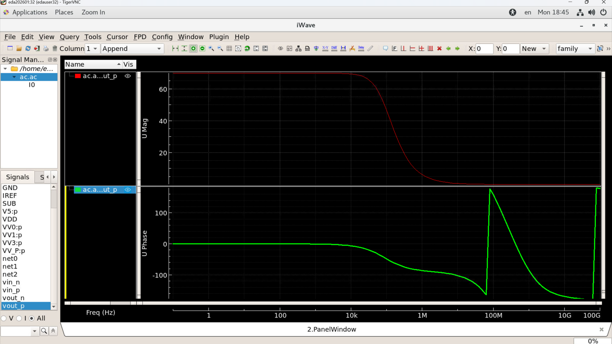
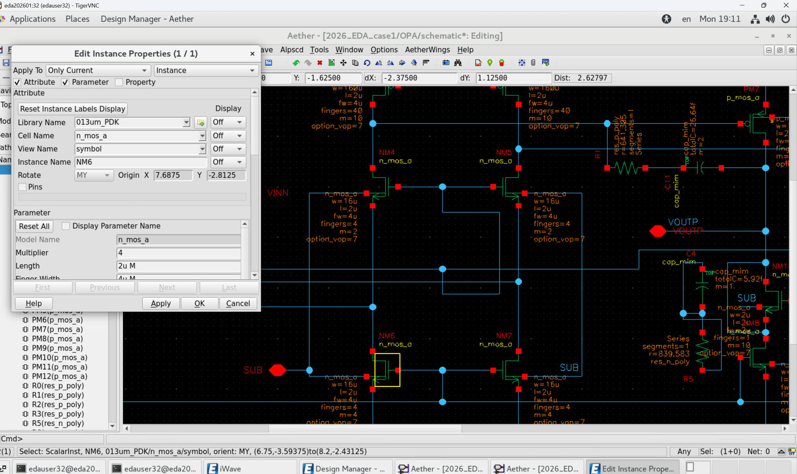
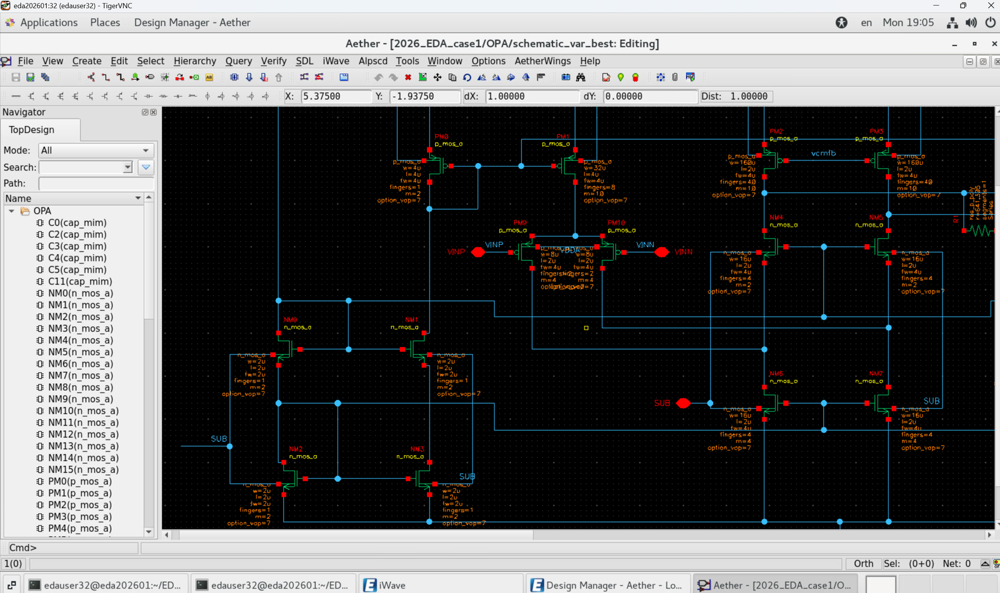

# 全 PVT 仿真验证报告

> 由 `module4/report_gen.py` 自动生成；数据源为 `sim_engine.py` 的真实仿真结果。
> 指标口径：PM/Gain/UGB 取所有 PVT 角的 **Min**，GM/I_OPA 取 **Max**（与赛方 `score.py` 一致）。

## 1. 基本信息

| 项 | 内容 |
|---|---|
| 电路 | `2026_EDA_case1 / OPA / schematic` |
| MDE | `OPA_loopgain / spe_state1_Corner` |
| 参数文件 | `/home/edauser32/EDA_2026_Empyrean_lab_start/case1_params_0.txt`（105 个符号） |
| 结果名 | `Results1080` |
| 旧路径修复 | 扫描 122 个文件，改动 0 个 |

## 2. 优化前后对比

| 指标 | 初始解 | 最优解 | 变化 |
|---|---|---|---|
| PM (deg) | — | 73.1725 | — |
| GM (dB) | — | -15.0247 | — |
| DC Gain (dB) | — | 29.4006 | — |
| UGB (Hz) | — | 7.641e+06 | — |
| I_OPA (A) | — | 0.0016 | — |
| Total_Area (µm²) | — | 11299.2 | — |

## 3. 最坏情况指标与达标判定

| 指标 | 最坏值 | 门限 | 判定 |
|---|---|---|---|
| PM | 73.1725 | ≥ 50 deg | ✅ |
| GM | -15.0247 | ≤ -10 dB | ✅ |
| I_OPA | 0.0016 | ≤ 0.003 A | ✅ |
| Gain | 29.4006 | ≥ 20 dB | ✅ |
| Total_Area | 11299.2 µm² | ≤ 8000 满分 | ⚠️ |

- 估算得分（不含时间分）：**58.27 / 80**
- 三条硬约束：全部满足 ✅

## 4. 全 PVT 逐角明细

| corner | process | temp | vdd | Phase_Margin | Gain_Margin | Gain_db | UGB | I_OPA |
|---|---|---|---|---|---|---|---|---|
| Nominal | tt | 27.0 | 1.8 | 74.762 | -15.8157 | 42.8995 | 12540100.0 | 0.00154046 |
| C1_0 | ff | -40.0 | 1.62 | 73.1725 | -15.4998 | 41.6674 | 15959400.0 | 0.00152552 |
| C1_1 | ff | 125.0 | 1.62 | 74.51 | -16.1593 | 33.0196 | 10072900.0 | 0.00151177 |
| C1_2 | ff | -40.0 | 1.98 | 73.4591 | -15.0604 | 45.905 | 17537800.0 | 0.00155274 |
| C1_3 | ff | 125.0 | 1.98 | 73.791 | -15.0247 | 42.3455 | 11810600.0 | 0.00153524 |
| C1_4 | ss | -40.0 | 1.62 | 75.1069 | -17.8271 | 35.4128 | 12095500.0 | 0.00153656 |
| C1_5 | ss | 125.0 | 1.62 | 77.4888 | -18.1629 | 29.4006 | 7641140.0 | 0.00151584 |
| C1_6 | ss | -40.0 | 1.98 | 75.8799 | -16.4806 | 46.4404 | 14377900.0 | 0.00156799 |
| C1_7 | ss | 125.0 | 1.98 | 76.127 | -16.3781 | 42.5941 | 9487810.0 | 0.00154652 |

### 4.1 全场景覆盖检查（赛题 6.2 第 5 项）

| 要求 | 是否覆盖 |
|---|---|
| 工艺角 TT | ✅ |
| 工艺角 FF | ✅ |
| 工艺角 SS | ✅ |
| 低温 −40℃ | ✅ |
| 高温 125℃ | ✅ |
| 标称电压 ±10% | ✅ |
| 常温 27℃（Nominal） | ✅ |

## 5. 波形与电路图

### 5.1 仿真波形（AC 扫频 / Bode）

- `03_bode_nominal.png`

  

### 5.2 电路图（参数化 / 反标后）

- `01_schematic_parameterized.png`

  

- `02_schematic_var_best.png`

  

## 6. 代码质量与算法性能

> ⚠️ 未提供优化日志（`--opt_log`），无法汇总评估次数/耗时/内存。

## 7. 结论

最优尺寸在全部 PVT 角下满足硬约束；
最坏情况 DC Gain = 29.4006 dB、UGB = 7.641e+06 Hz、Area = 11299.2 µm²。

后续可继续提升：UGB（距满分基线 2e+08 Hz 还差 26.17 倍）；面积（距满分 8000 µm² 还差 29.2%）。

